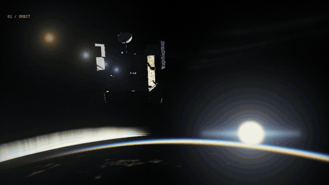
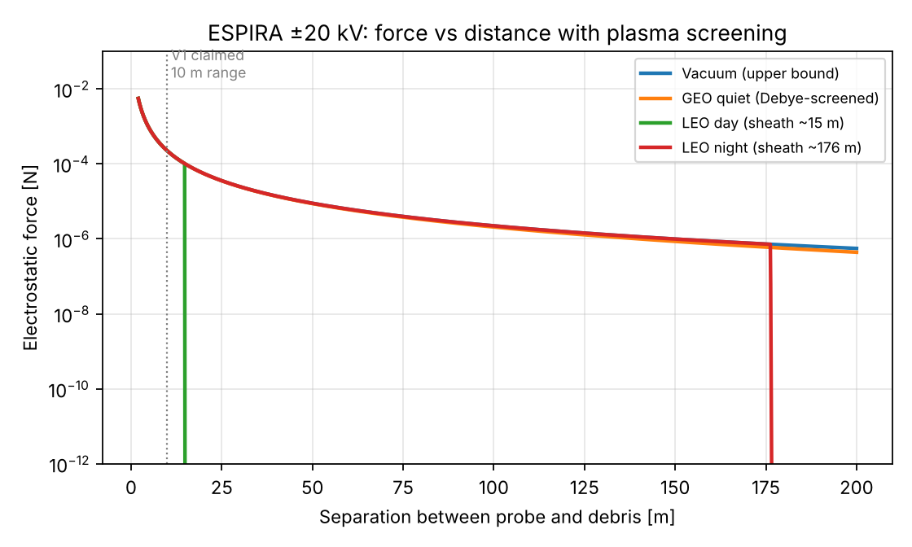
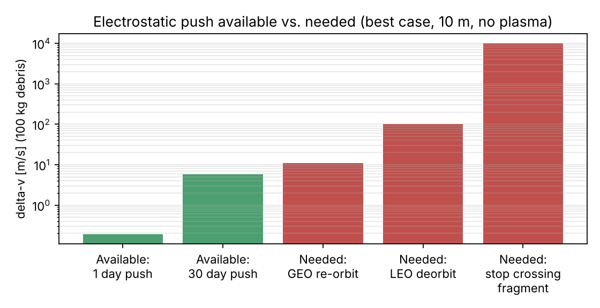
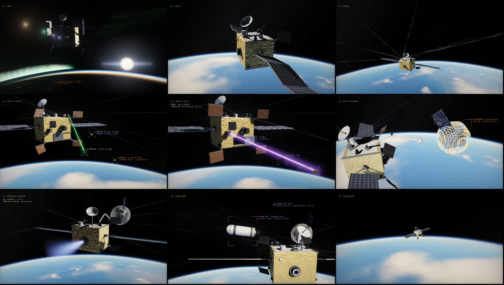

<div align="center">



# ESPIRA

### Can electrostatic forces clean up low Earth orbit?

**Electrostatic Space Particle Interception & Removal Architecture**
*A spacecraft concept, a computational feasibility study, and a real-time rendering engine*

**Harshita Pandita** · 2025–26

[**Live project site**](https://hersheyharshi.github.io/espira/) ·
[**Mission film**](https://hersheyharshi.github.io/espira/film.html) ·
[**Interactive 3D model**](https://hersheyharshi.github.io/espira/model.html) ·
[**Technical paper (PDF)**](ESPIRA_technical_note.pdf) ·
[**Analysis code**](analysis/espira_feasibility.py)
[](https://doi.org/10.5281/zenodo.24129056)


</div>

---

## Abstract

ESPIRA is a concept for a ~383 kg debris-removal spacecraft in a 550 km sun-synchronous orbit. It borrows the principle of an industrial electrostatic precipitator: **charge** a debris object with an electron beam or UV light, then **move** it with ±20 kV field panels. A second-generation design (V2) adds five subsystems: a 200 m charged filament web, a quantum material sensor, an adaptive-grip capture net, a neuromorphic decision chip and a stigmergic swarm beacon.

I then tested the core mechanism with first-order physics: plasma screening, spacecraft charging, Coulomb force and plasma current collection. **The concept as designed is not viable in low Earth orbit (LEO).** The ionospheric plasma surrounds a 20 kV body with a 15–180 m sheath. Holding that voltage would draw an estimated **19–24 kW against a 1.4 kW array**, and the resulting forces (~0.2 mN at 10 m) are far too small for debris that moves relative to the probe. The same plasma, however, is what makes **electrodynamic tethers** work in LEO, while electrostatic actuation remains credible for slow tasks in geostationary orbit (GEO). The project ends with that revised direction.

## Key findings

| | Result | Why it matters |
|---|---|---|
| **Power** | Holding ±20 kV in LEO plasma needs **~19–24 kW**. The array supplies 1.4 kW. | The plasma drains charge faster than the spacecraft can replace it. |
| **Force** | ~0.2 mN at 10 m (best case). A month of push gives a 100 kg object **~6 m/s**; deorbit needs **~100 m/s**. | Electrostatics suits slow GEO re-orbiting, not LEO removal. |
| **MYCENET** | With realistic debris densities, a >10 cm object crosses the web **about once every 175 years**. A 1 cm fragment at 10 km/s carries **~10⁶×** more energy than the field can remove. | Fragments would cut the filaments rather than be captured. |

<p align="center">
  
  
</p>

## Technical highlights

| Area | What was built |
|---|---|
| **Computational modelling** | A reproducible Python model (NumPy, Matplotlib) of plasma screening, spacecraft charging, sheath growth, current collection, Δv budgets and debris encounter rates. Every number in the paper comes from one script. |
| **Model-driven decision** | The model was used to test the design's core assumption, and its result overturned it. The findings and the revised direction follow from the data, not from the original idea. |
| **Interactive tooling** | A browser calculator running the same equations as the Python model, so anyone can change orbit, voltage, distance and mass and see the effect live. |
| **Real-time rendering engine** | A multi-pass WebGL2 pipeline written from scratch, with no 3D library: <br>• GPU-baked procedural Earth (cube maps) <br>• precomputed atmospheric transmittance table <br>• single-scattering atmosphere <br>• signed-distance-field raymarching with soft shadows and ambient occlusion <br>• HDR bloom chain and FXAA <br>• adaptive-resolution frame-time controller <br>• parallel shader compilation with poster-first loading |
| **Data overlay** | A mission display that projects 3D state into screen space: target tracking, label collision avoidance, and a spiking-neuron activity panel. |
| **Machine-learning design** | NEUROTRIAGE (event-driven spiking-neural-network inference for strategy selection) and SPINDAR (material classification from magnetometry signatures). Both are specified as ML problems, with latency and energy budgets. |

## The concept: one probe, many mechanisms

ESPIRA works in three steps, like a dust precipitator: **charge** the debris → create a **field** → **move** it, without contact. Each mechanism below has its own chapter in the [mission film](https://hersheyharshi.github.io/espira/film.html).

| Mechanism | Role | Key design values (targets) | Film chapter |
|---|---|---|---|
| Solar arrays + cold-gas RCS | Power and attitude | 1.4 kW BOL | 02 Deploy |
| **MYCENET** (V2) | 9 carbon-nanotube filaments charge debris that touches them | −10 kV, reach 200 m | 03 MYCENET |
| Hybrid sensor array | Camera, 360° LIDAR and radar: size, shape, tumble rate | 16 MP, 360° scan | 04 Detect |
| **SPINDAR** (V2) | NV-diamond magnetometer + 532 nm laser identifies the material | 5–15 m range | 04 Detect |
| **NEUROTRIAGE** (V2) | Spiking neural network picks the capture strategy | < 80 ms, ~50 µJ per decision | 04 Detect |
| Electron beam (V2 phased array) | Charges metal fragments; 16 micro-emitters steer electronically | 0.5–5 keV, 0.5–8 m, ±45° | 05 Collect |
| UV photon emitter | Photoelectric charging for non-conductors (Kapton) | 185–254 nm | 05 Collect |
| Electrostatic field panels | 4 adjustable fins attract or repel charged debris | ±20 kV, up to 8 m | 05 Collect |
| Storage bay | Holds and compacts captured fragments | 0.12 m³, magnetic lining | 05 Collect |
| Net arm | 3-DOF arm firing a Dyneema-copper net at objects > 10 cm | 3 × 3 m net | 06 Net |
| **ELECTROSKIN** (V2) | Net tiles that grip where debris presses, so tumbling objects cannot bounce out | 9 tiles, < 2 ms switching | 06 Net |
| Xenon Hall thruster | Propulsion, and neutralising the hull charge after capture | ~90 mN | 07 Neutralise |
| High-gain antenna | Encounter data downlink | X-band, 150 Mbps | 07 Neutralise |
| **STIGMA** (V2) | Tags debris it cannot take with a coded charge; aft beacon keeps probes ≥ 500 m apart | 2 km beacon range | 08 STIGMA |

All values are design targets from the concept study. None has been tested. Section 5 of the [technical paper](ESPIRA_technical_note.pdf) gives the feasibility verdict for each V2 subsystem.

## Feasibility analysis

The analysis is a single, dependency-light Python script built from standard first-order models:

- the electron **Debye length** (how far a plasma lets a field reach)
- **sphere charge**, Q = 4πε₀RV
- a **Debye-screened Coulomb force**, as used in the electrostatic-tractor literature
- the **Child–Langmuir sheath** thickness at kilovolt potentials
- the **plasma current** collected across the sheath, which sets the power needed
- a **Δv budget**, and the **MYCENET encounter rate**

```bash
pip install -r analysis/requirements.txt
python analysis/espira_feasibility.py      # prints every number in the paper, saves figures to analysis/figures/
```

The [project site](https://hersheyharshi.github.io/espira/#test) also has an **interactive calculator** with the same equations. Change the orbit, voltage, distance and mass, and watch the power and force respond.

## Revised direction

| Orbit | Approach | Why |
|---|---|---|
| **GEO** | Electrostatic tractor (slow, co-orbital) | Debye length is hundreds of metres, and holding high voltage costs ~0.2 W |
| **LEO** | Electrodynamic tether deorbit kit | The ionosphere supplies the current. F = ILB ≈ 1 A × 1 km × 30 µT ≈ 30 mN, more than 100× ESPIRA's best electrostatic force |

ESPIRA's adaptive-grip net (ELECTROSKIN) and tumble-aware capture logic carry over to a chaser that attaches a tether kit to large objects such as spent rocket stages.

## The mission film

<p align="center"></p>

An 80-second, nine-chapter sequence **rendered live in the browser** with custom WebGL2 shaders and no external libraries:

- **Earth:** a physically based atmosphere (Rayleigh and Mie scattering), and a procedural planet with clouds, cloud shadows, city lights and an aurora
- **Spacecraft:** raymarched geometry with physically based materials and soft shadows
- **Camera effects:** HDR bloom and edge smoothing
- **Mission overlay:** labels each mechanism as it operates

The film is a concept visualisation of the design as intended. The analysis above explains why it would not work as shown in LEO. On-screen example values (fragment sizes, spin rates, the 812 m separation) are illustrative.

[**▶ Watch it live**](https://hersheyharshi.github.io/espira/film.html) · [Download the trailer (MP4)](media/espira-trailer.mp4)

## Repository structure

```
espira/
├── index.html                    # project site: story, interactive calculator, findings
├── film.html                     # real-time mission film (WebGL2)
├── model.html                    # interactive 3D model of the probe
├── ESPIRA_technical_note.pdf     # 5-page technical paper
├── analysis/
│   ├── espira_feasibility.py     # reproduces every number in the paper
│   ├── requirements.txt
│   ├── results.txt               # output of the last run
│   └── figures/                  # force-distance and Δv figures
├── media/                        # trailer, chapter stills, social preview
├── CITATION.cff
└── LICENSE
```

## Limitations and next steps

The models are deliberately first-order. They are enough to rule out the original LEO concept but too coarse for new design work.

- **Geometry:** isolated spheres stand in for real shapes. The multi-sphere method would capture shape effects.
- **Plasma:** sheath and current estimates use planar Child–Langmuir theory. A spacecraft-charging code (SPIS) would give the true equilibrium potentials.
- **Debris densities:** these are order-of-magnitude values, not ESA MASTER flux for a specific orbit.

**Next steps:**
1. Reproduce a published GEO electrostatic-tractor result to validate the model.
2. Model the deorbit time of an electrodynamic tether kit on a ~1 t object from 550–800 km.
3. Simulate tumbling-object contact with passive versus adaptive-grip nets.

## How to cite

If you refer to this work, please cite it using the metadata in [`CITATION.cff`](CITATION.cff) (GitHub shows a **"Cite this repository"** button).

## References

1. ESA Space Debris Office, [*ESA Space Environment Report 2025*](https://www.esa.int/Space_Safety/Space_Debris/ESA_Space_Environment_Report_2025); [DISCOSweb statistics](https://sdup.esoc.esa.int/discosweb/statistics/).
2. Bengtson, Wilson, Hughes & Schaub, "Survey of the electrostatic tractor research for reorbiting passive GEO space objects," *Astrodynamics* 2(4), 2018.
3. Hammerl & Schaub, "Effects of electric potential uncertainty on electrostatic tractor relative motion control," *8th European Conference on Space Debris*.
4. Sarego et al., "Deorbiting performance of electrodynamic tethers to mitigate space debris," University of Padova (E.T.PACK, H2020 grant 828902).
5. Olivieri et al., "Test of tethered deorbiting of space debris," *Advances in Astronautics Science and Technology*, 2020.

## Acknowledgements

Built with my own code and implementation, together with generative AI tools.

## License

Code (`.py`, `.html`) is released under the [MIT License](LICENSE). The technical paper, figures and media are released under [CC BY 4.0](https://creativecommons.org/licenses/by/4.0/).
